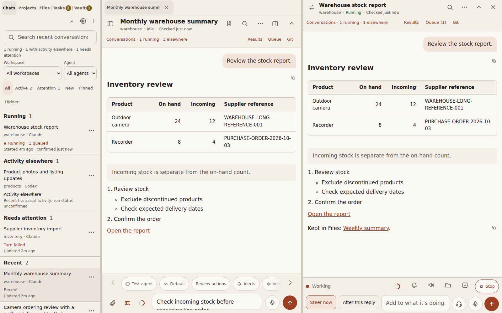

# Pocket Code workspace guide

This guide follows the current checkout, through release 1.37. Check
[CHANGELOG.md](../CHANGELOG.md) for which version has been released.

## Start or resume work

Open a session from the list or choose **New session**. New session uses the same message box as a
conversation (1.58): write the task in it and press the Send arrow (**Start session**), or Enter on a desktop.
The chips above the box set the model, reasoning, permissions and, for Codex, the mode, exactly as they
do for a conversation's next turn. Beside the box are **Attach**, the settings toggle, **Choose a skill**
(the spark), which inserts an editable instruction from that agent's installed skills without starting a
turn, and **Save as prompt** (the bookmark). The mic and the hands-free headset work as in a conversation:
the mic dictates the task, or starts the session with it unless Review before sending is on or you have
typed something; hands-free reads your instruction back, starts the session after "send it" or a tap on
Send, and the conversation carries on in the new session.

Above the box, the setup card names the workspace, the agent with its model and reasoning level (for
example *Claude Code · Opus 5.5 · High reasoning*) and the permissions. **Edit setup** chooses the agent
and the workspace; closing it preserves your draft. A custom workspace path must be a directory on the
server, not your phone. With no default workspace and nothing remembered, the most recent workspace is
preselected. If something is missing, the reason appears above the box. A briefing put in the box for you (an
Inbox alert's or start link's, a task's or project's **Start**) stays only for that visit: leave without starting
and the **+** button opens a clean conversation, unless you edited the briefing (1.69.3). Your own typed draft is kept.

**Saved prompts.** **Save as prompt** keeps the task with its workspace and agent (and, if you
keep them, model, effort, permissions and Codex mode). Saved prompts show as chips above the task
box; a tap fills the screen and you press Start. **Recent** lists your last five starts from any
device. **Manage** (or a long-press on a chip) reorders, renames, replaces and deletes them. They
are stored on the server, so every device sees the same list.

Pocket-specific defaults may preselect the workspace, model, effort and permissions.
Otherwise the app uses its remembered choices and the installed CLI's configuration.
Model and reasoning selectors affect subsequent turns. Codex also offers **Plan first**
and **Work normally**; Plan first is guidance, not a security sandbox.

Switching agents resets an incompatible model choice to Default. Opening an existing
session also repairs a saved choice from the other agent. Valid choices stay saved.
A Claude choice the picker no longer offers (see **Claude models in the picker** below)
goes back to Default; a Codex model the menu does not list is shown by its ID and still
sent, since Codex reports its own models. Older tabs that send a model for the wrong agent
receive a message to choose a model and send again; Pocket does not start or queue that request.

The session list distinguishes confirmed Pocket-owned runs from activity seen in an
external transcript. Search matches recent session titles and workspace paths.

A session's title is your rename, else the agent's own title, else a short title
Pocket generates from the opening request. Clearing a rename returns to that title.

**Settings → Conversation → Sync names with code-server** (off by default, for the whole server)
shares session names with Claude Code itself. With it on, a rename made in Claude Code or code-server
shows in Pocket, and a rename made in Pocket is written into the session as the same record Claude Code's
own rename writes, so code-server and `claude --resume` show it too. Codex sessions get the new name as
their thread name. With it off, Pocket names stay in Pocket, and Claude Code's own generated title still
shows ahead of the opening request. Clearing a rename in Pocket only clears Pocket's name: a record
already written to the session cannot be taken back.

**Settings → Conversation → Generate short titles** turns generation on or off for the whole server
(on by default), and **Model for titles and summaries** picks who writes them. The same choice writes
the **While you were away** summaries and the briefing kept with a task made with *Include a summary
of this session*:

| Choice | Uses | Cost per title |
|---|---|---|
| Automatic: Claude first, then Codex | Claude when its CLI is installed and signed in, otherwise Codex | as below |
| Claude · Haiku | `claude -p --model haiku`, no tools, no saved session (another allowed model when this computer's Claude Code policy blocks Haiku) | about 400 tokens |
| Codex · GPT-6-Luna | `codex exec --ephemeral`, read-only, low effort | about 25k tokens (Codex's built-in instructions) |

Calls run on that CLI's own sign-in: your Claude or ChatGPT subscription, or an API key
if the CLI uses one. Titles are kept in `session-meta.json`, never written to a
transcript, made one at a time, and only for sessions active in the last 14 days. A summary or
briefing costs a few thousand Claude tokens, or about 25k with Codex.

**Settings → Update titles as sessions progress** (on by default) keeps a title current.
After a turn run from Pocket ends, a session that has grown enough since its last check
(four more of your turns or about 8k characters, at least ten minutes apart) is shown to
the same helper model as a digest of the whole session with its current title. The model
keeps the title or writes a better one, naming both topics when the session took a second
turn. An updated title ranks ahead of Claude Code's own one-shot title and behind a
rename, which is never touched; earlier titles stay in `session-meta.json`. A Claude
check costs a few thousand tokens, a Codex check about 25k.
A provider that is not installed, not signed in, or (Codex) does not offer GPT-6-Luna is
shown as unavailable with the reason; with neither available no calls are made. Turning
titles off also hides the ones already made, so the list matches code-server when Sync
names with code-server is on. Claude's `haiku` alias follows the installed CLI: update
Claude Code to move titles to the newest Haiku.

**Search inside conversations.** Three or more characters in a session search box also
search inside conversations after a short pause. The **In conversations** section shows the
matching passage and who wrote it; tapping a result opens the conversation with Find on the
match. With [MemStem](https://github.com/Memstem/memstem) beside Pocket the search covers
every session by wording and meaning (sessions that only match by meaning say **Related**);
without it, Pocket searches the 200 most recent conversations for the exact phrase, for up to
six seconds, and says how many it covered.

Scheduled runs that open with `[cron:<id> Job name]` (or an OpenClaw runtime preamble)
are marked automated, show the job name, and sit in a collapsed **Automated** group at
the end of **All**. Search, the other filters, pins, running work and anything needing
attention show them as usual. Sessions in `/tmp/` workspaces are left out unless pinned
or running.
Find in conversation searches the open conversation, including older transcript matches.

**All**, **Active** and **Attention** stay visible on the home list and switcher.
**Filters** contains workspace, agent, New, Pinned and Hidden choices. Its expansion
is remembered on this browser; applied secondary filters remain in the summary.
The desktop rail has its own independent Filters disclosure.

Pinning and renaming are server-side. Hiding a session is local to this browser,
preserves history, and is reversed by new activity. Active or waiting work stays visible.

Pinned sessions keep an order of their own, saved on the server so every device agrees.
On desktop widths each pinned row has a grip: drag it onto another pinned row, or focus
it and press the up and down arrow keys. Session options offers **Move pin up** and
**Move pin down** on any device. A newly pinned session follows the ordered pins by
recency; unpinning forgets its place.

## Desktop workspace

The left rail finds sessions. Open-session tabs keep recent work within reach. A pinned
session's tab shows the pin and its title in the accent, and pinned tabs come first in
the pinned order, then the rest in the order opened; Alt [ / ] follow the same order.
Each tab also shows its session's status before the title, matching the rail row: the
breathing ember while a turn runs, an amber dot when it needs you, green for an unread
reply, red for a failed turn and a ring for activity elsewhere or a paused queue.
Quiet sessions show no mark. Hover a tab to read the status.
The panel icon beside the conversation title hides the rail; drag its divider or
use its arrow keys to resize it.

Use **Split view** in the conversation header to open an existing session or a
**New session** beside it. A session row's menu also offers **Open beside** when a
main conversation is open. There can be up to four conversations, including the main
one, if the window has room. One unstarted New-session pane is allowed at a time.

Each pane has its own conversation, composer, stream, draft and request dialogs.
The pane's swap button exchanges it with the main conversation. Drag a divider or
focus it and use Left/Right to resize; double-click restores equal sharing.

Each conversation needs at least 380px, in addition to rail, dock and divider space.
When the window narrows or the rail expands, panes that do not fit hide in place.
They return when room is available. Below 900px, split panes are hidden. Hiding does
not reload the frame, discard the draft, release a process or stop work.

**Results**, **Queue** and **Git** open in a workspace panel on wide screens (1280px+)
and in a sheet at narrower widths. The panel's width is included when deciding how
many conversation panes fit. A panel that becomes a sheet retains its fields.

## Closing views and processes

| Control | Effect |
|---|---|
| X on an open-session tab | Removes that local tab. The session and any work continue. |
| X on an existing-session side pane | Closes that view. The server session continues. |
| X on an unstarted New-session pane | Removes that pane's unsent draft, attachments, choices and retry state. |
| Session options → Close session process | Releases the process if idle. Active work prompts for Keep running or Stop. |
| Keep it running in the background | Closes the main view while the server work continues. |
| Stop the turn | Interrupts the work before closing the main view. |
| Stop in the composer | Interrupts the current turn and pauses automatic follow-up drain. |

Closing the main session promotes the first side pane, or opens New session if none
is available. Promoting a New-session pane brings its draft and saved start state.
No close control deletes the saved conversation. Releasing a Codex session also frees
its writer lock so another surface can continue the thread.

## Conversation, results and files

Assistant output reads as a document: headings, lists, tables, quotes, code and task
checklists. On wide screens prose stops at a readable line length (about 68 characters'
width at the chosen text size) while tables and code use the full width. Wide tables
scroll within their own region. Tool activity appears in
compact ledger rows; copy controls copy message text or code. The newest plan is
expanded and older plans are collapsible.

Consecutive tool calls fold behind one line that gives the count and the latest call (for
example *12 tool calls · Edit app.js*). **Settings → Conversation → Collapse tool calls**, on by
default, keeps them folded; turn it off to open every fold. It is a choice for this browser.

**Message times (1.24).** Each message shows when it was sent: under your own messages, above each
reply, with a divider at the first message of each day (Today, Yesterday, then the weekday and date). A message
from an earlier day carries its date in the time. Times come from the transcript, so Claude and
Codex sessions both have them; a message that is not in the transcript yet shows none, and Copy
message and Find in conversation never include them. **Settings → Conversation → Show message
times** turns the times and dividers off on this browser (on by default).

**Results** collects links and report paths referenced by assistant messages. Search
or refresh that panel to find a result. A reference does not prove that a file was
successfully created. Existing external links retain their own access rules.

Supported local report downloads require login, a reference in that conversation,
and a path inside the operator's home directory outside hidden folders. The server
limits results to recent references; older ones may still be in the transcript.

**Changed files** shows edits recorded in this session's transcript. **Git** shows
the entire working tree, including changes by other sessions. Git inspection is read-only:
working and staged diffs are separate; sensitive paths and symlink escapes cannot be
previewed. Untracked files are listed without a content preview. The limits are
250 changed files and 256 KB per diff.

Attach files with the paperclip, paste an image into the message field, or choose
**Paste screenshot**. Clipboard support depends on the browser and embedding permissions.
Wait for uploads to finish before sending. An upload remains attached to the session
where it began, even if you switch conversations before it completes.

Drafts and attachment references survive a reload on the same browser. When delivery
is uncertain, **Retry same message** checks the original request identifier; it does
not intentionally create another turn. Review the conversation before discarding
an uncertain retry.

**While you were away.** Opening a session that kept working while you were gone (or
returning to the app) opens the conversation at the end, with a **New since …** line
before the first message you have not seen. "Since" is the later of the reviewed marker
shared by your devices and the last time this browser had the conversation on screen.
An away card under the latest message repeats the time and offers **Read from there**,
which jumps to the line and keeps the view there until you scroll, tap or type. When the
new part is more than a short exchange, the card also summarizes it in two to four lines
and names the model that wrote it; when the latest reply ends in suggested replies, the
card sits above them. The summary uses the model chosen under **Settings → Model for
titles and summaries** and only the new messages; turn it off with **Summarize what you
missed** (the line and the card stay).

When the last turn failed, the end of the conversation says so, with the reason when
the agent gave one, and offers **Send again** (the last message, as a new turn) and
**Edit message** (puts it in the message box). Neither replaces a draft you are typing.
The notice comes from the server, so it is still there after a reload or on another device. See [delivery recovery](operations.md#delivery-and-queue-recovery).

## Steering and follow-up queues

While a turn runs, **Steer now** delivers a correction into the active turn. It does
not start an independent turn or change the running turn's model or permissions.
**After this turn** saves a separate instruction for later execution.

Open **Queue** to edit, remove or run pending instructions. Editing reserves the row
so it cannot dispatch until saved or canceled. Closing the editor leaves it paused;
Continue editing recovers this browser's unsaved draft. Other devices see the paused
server row but not that local draft. Stale edits are rejected by revision checks.

Stopping or failing a turn pauses automatic drain. A later successful turn can resume
the backlog. After a daemon restart, a queue without an owned run waits for a new
turn or **Run next instruction**. An uncertain dispatch blocks later entries until
its outcome is reviewed and the uncertain row is removed.

**Usage limits.** When a Claude turn from Pocket fails on a usage or rate limit, Pocket does not
leave it there. It reads the reset time from the error and schedules the session to continue five
minutes after the reset (`POCKET_RETRY_BUFFER_MS` changes the wait; if the error gives no usable time,
Pocket tries again in an hour, and it never waits more than 12 hours). The conversation says *Rate
limited — auto-resume at* the time, and the session shows **Waiting for usage reset** in the list.
At that time Pocket resumes the session with a short instruction to continue where it left off.
Push tells you when the turn is rate limited (if you were not watching) and when it picks the work
back up. The schedule survives a server restart. A turn you stop, a
session with saved follow-up instructions, or a session you have already continued from another
surface is not resumed, sending a message yourself cancels the pending resume, and Pocket gives up
after six automatic attempts in a row. Codex turns are not resumed this way.

## Questions, permissions and status

**Attention** collects everything waiting on you: agent questions, action approvals, failed turns, and
replies marked Response ready that you have not opened yet. Opening a session clears its Response ready.
To clear one without opening it, long-press the session (or tap ⋯) and choose **Mark as reviewed**; a
failed turn clears the same way. In **Attention** and **New**, the bar above the list offers **Mark all
reviewed**, with **Undo** for 10 seconds. Questions and approvals stay until you answer them. Opening or marking a
session reviewed counts on all your devices: clear it at your desk and it is gone from your phone too.

**Reply suggestions.** Pocket asks Claude and Codex to end a closing question that offers specific next
steps with a short list of options. Pocket shows them as buttons under the latest reply once the turn has
finished; a tap sends that option as your next message, exactly as if you had typed it. When the agent has a
clear recommendation, that button is filled and tagged **Recommended**; the tag is a hint, not part of what a
tap sends, and an even choice has no tag. Typing in the
message box hides them, and the X dismisses them for that reply. They never appear mid-turn: questions
an agent asks while it works still use the question form. The instruction is added only to turns Pocket
runs (Claude via `--append-system-prompt`, Codex via thread developer instructions; a Codex config that
sets its own `developer_instructions` is left alone and gets no suggestions). Sessions run from a
terminal or editor show no buttons. Set `POCKET_CHOICES=0` to turn the instruction off.

Native questions and approval requests appear in separate banners. Answers require
an explicit submission. Approval cards show the action and offer Allow or Deny;
closing a dialog or losing the browser connection does not approve it.

**Review actions** is the default. **Full access** allows unattended execution if the
operator permits it. A mode choice applies to the next turn and is captured with a
queued instruction; it does not change an active turn. See [action approvals](action-approvals.md)
for provider-specific scope, restart handling and limitations. Read-only Claude actions the owner
lists in Settings run without a card in Review actions; see
[Actions that run without asking](#actions-that-run-without-asking).

The conversation has one header (1.35). Under the title, a subtitle line names the project, the
run status in short words (Idle, Running, Background, Needs your answer) and the age of the last server
check; hover or long-press the status for the detail (for Background, the jobs still running). **Sessions**, **Results**, **Queue** and
**Git** sit in the same bar, on the title row when the header is wide and on a second line
inside the header when it is narrow; a phone keeps the check age in the tooltip. The run
status stays visible when the header collapses. The check time
moves in steps (just now, 10s ago, 1m ago) so a healthy check does not tick every second. Only a fresh
server status response confirms an owned run. Failed checks or stale proof remove
that confirmation; a locally ticking timer is not evidence that work is progressing.
An external transcript can show activity without proving a process is still running.
Browser suspension may pause status refresh; the server turn remains independent.

The context ring sits beside the composer's settings button (in the working row while a turn runs). It
fills as the session's context window fills, turning amber at 70% and red at 90%. Hover or focus it for
the model, tokens used, the window size and the percentage; click it for this session's usage: the context
window (window, used, free, as of) and the provider's plan limits. Estimates are labelled. It shows the
latest known context relative to the model window, not cumulative token billing for the whole turn.

Beside the ring, Claude sessions show how long the prompt cache stays warm (1.28): minutes left, amber in
the last stretch, `cold` once it has expired, when the ring turns ice blue (1.28.1). Claude caches the session's context after each request for a
lifetime (one hour on a normal plan, five minutes in some cases such as extra usage); a turn that starts
while it is warm reads the context cheaply, while a turn after it expires writes the whole context to cache
again. Usage → **Prompt cache** gives the status, expiry, cached tokens, lifetime and how the last turn
started; each reply's turn line adds "97% cached" or "cold start". Open-session tabs mark sessions with
at least 100k cached tokens with an hourglass when the cache is about to expire and a snowflake once it has.
All of this is an estimate from the transcript's last request, so it includes turns run in a terminal or
code-server; the provider can drop a cache sooner. Codex sessions show no cache figures.

## Projects

Projects (1.29) keep the work that comes out of sessions beside the sessions. The feature
is off until **Settings → Projects, files, tasks & vault → Projects** turns it on for the whole install.

Projects, Files and Tasks keep up without a reload (1.44.1): an open list or card refreshes
when the window comes back into focus, when a turn ends in any Pocket window on the device
(a split pane, a window of its own, another tab), and when you open it, so a project, file or
task an agent adds mid-turn appears on its own. A list left open also checks every 30 seconds.

A project is one card: where you left off, the next step, what it is waiting for, a
directory and a link, a checklist of remaining steps, reminders, notes, history, and the
sessions that worked on it, each with its live status mark. States are Active, Waiting and
Done. Finishing a project stops its reminders; resuming it does not bring them back.
A reminder belongs to the project or to one step; finishing the step stops its reminder,
and a new reminder on the same project or step replaces the open one (that is what
*Remind later* does). An edit made from a stale card is refused and the current card is
shown.

Projects are tracked only when you ask: **Track a project** on the list, the **Add project**
chip in a conversation's message toolbar (beside Alerts, Voice and Add task; a folder button in the working row while
a turn runs, and the project's name once the session is linked), or **Add project** in a session's options, which tracks a new project around the session (its
workspace becomes the directory) or links the session to an existing one. Either entry opens the
**Project for this session** sheet: **Track a new project**, or one of your open projects to add the
session to. Agents keep a
card current with the `pocket-board` command (see [Agent commands](../README.md#agent-commands)); they may track a project
only with `--requested`, so nothing enrolls work by inference. With Projects on, agents
started by Pocket are told how, and told to do it only when you ask, so "track this as a
project" works in any session.

**Start session** (1.49; on the card, and first in the project's options) opens a New session in the
project's directory with a briefing already written as the first message: where you left off, the
next step, what it is waiting for, the open steps with their ids, the last three notes, open
reminders, the link and the last three sessions that worked on it, plus how to keep the card
current. Edit it if you like, then Start. The new session is linked to the project as it starts, so
the card lists it; the project's chip above the setup card shows which project it will join, and
tapping it removes the link before you start. The agent is the one that last worked on the project.

**Where reminders are listed.** With Tasks on (1.50), every open reminder appears in the
[Tasks](#tasks) list among the dated tasks, soonest first, each opening its card; the Projects
list's **Reminders** chip goes there, and `#/projects/scheduled` opens it. Without Tasks,
**Scheduled** lists every open reminder across projects, due first. Only reminders Pocket
Code itself keeps appear in either. When a reminder comes due it is sent once to your devices
by push, with a link to the card and a **Tomorrow** action that moves it to 9 AM the next
day, once to the server's reminder hook if the operator set one, and by email when
[Settings → Notifications & voice](#settings-notifications-and-compact-views) has an address;
the card and the list keep showing it as due until you dismiss it or set a new time.

On the desktop the rail head switches between **Sessions | Projects | Files | Tasks**
(a segment appears when its feature is on), and Projects shows the count of due reminders while Tasks is off; with Tasks on, the Tasks segment counts tasks and reminders together. Pick a project from the rail and it opens as a tab in the same
strip as sessions (pinning, closing and Alt [ / ] work the same; the tab's mark is the due
count), beside the conversation, or in a new browser window of its own, whichever
Settings → Projects, files, tasks & vault says; the options sheet and the view header offer all three every time.
*Open beside* and *Split view* also offer Projects, Scheduled and the active projects. On
the phone, the session home shows a **Projects** chip and views open full-screen.

On a desktop (900px and wider) every sheet, such as a project's or file's options,
Share, a session's options and Settings, opens as a dialog in the middle of the window;
on a phone it stays a sheet from the bottom edge.

## Files

Files (1.30; called Documents before 1.34) is the library of files that came out of
sessions: HTML reports and dashboards, PDFs, images, Markdown, text, CSV, JSON, Office files
and video. It is off until **Settings → Projects, files, tasks & vault → Files** turns it on for the
whole install.

A file gets in four ways: an agent keeps it with `pocket-docs add` (agents started by
Pocket are told to do this for deliverables, linked to the session, and never to share
unless you ask); **Keep in Files** on a file in a session's Results panel; **Upload**
in the library or the rail; or a file placed in the library's folder on the server
(`POCKET_DOCUMENTS_DIR`), which appears as a private file on the next listing. Each file
knows the session and project it came from; a project card lists its files and the library
filters by project.

HTML renders in a sandboxed frame that keeps the file away from Pocket's cookies, storage
and API while its own scripts still run. PDFs, images, Markdown, text, CSV and JSON render
natively. **Open in your viewer** hands the file to the device (a PDF to the phone's PDF
app); **Download** saves it. Office files and video always open that way.

**Share** sets the visibility: *Private* (behind the Pocket login), *Anyone with the link*
(an unguessable address, with an optional expiry; *New link* revokes the old one) or
*Public* (a fixed address by file name). All are served by Pocket on its own hostname.
**Remove** moves a file to the trash for 30 days, where *Restore* brings it back; any link
stops working at once.

**Several at once (1.45).** **Select** beside Upload turns the library into checkboxes: tick
files, or **Select all** for what the search and filters show, then **Remove** moves them all
to the trash after one confirmation. A file a search or filter hides is dropped from the
selection, so Remove only ever reaches files on screen. **Done** or Escape leaves select mode.

**The trash.** Each removed file has *Restore* and, in its options, **Delete forever**;
**Empty trash** deletes everything in it. Both ask once, then delete the file and its preview
from the server at once and free the space; neither can be undone. Only you can do this: an
agent's `pocket-docs` can move one file to the trash, never delete one.

**The grid.** From 700px up the library is a grid of previews: a picture of each HTML
report, PDF first page or image, with the title, kind, visibility and date under it, and Copy
link and the options button on the picture. The List and Grid buttons above the library
switch between the rows and the grid, remembered per browser; phones keep the list. A split
pane keeps the grid at any width, with smaller cards (1.37.2). The
server makes each picture once with tools on the box (headless Chrome, `pdftoppm`,
ImageMagick) and caches it beside the files; a kind it cannot picture shows its name.

**Finding a file.** The library's search covers the title, file name, project, session,
kind and visibility; chips narrow the list to Private, Link or Public files (with counts),
the Kind filter to HTML reports, PDFs, images, Markdown and text, CSV and JSON, or Office
and video, and the Project filter to one project; *Clear* resets them. Each row shows a
visibility badge, and a shared row has a **Copy link** button beside its options. The
rail's Files list has the same search.

Files open three ways, like projects: as a tab in the strip, beside a conversation
(*Open beside* and *Split view* offer the library), or **in a new window**, a browser tab or
app window of its own with no session list or tab strip (every options sheet and view
header offers it). On the phone they open full-screen. The rail head's switch reads
**Sessions | Projects | Files | Tasks**, with a light divider between them; the phone's session
home gets a Files chip. The rail's Files list has three buttons: **Upload**, **Split**
(the library in a pane beside the current view) and **Tab** (the library as a tab).
Settings → Projects, files, tasks & vault → **Files button** chooses what the Files segment does: list
files in the sidebar (the default), or open the library straight away in a tab or in split
view. **Open files and links** chooses whether a plain click on a file opens a tab, a pane or a new
window. Since 1.54 a link in a conversation (or in the Results panel) to one of this Pocket's
own things opens the same way: a Pocket address opens that view, a share link to one of your
files opens the file, and an image or file served by Pocket shows in a small link view with
**Open in browser** and **Copy link** above it. A download stays a download, and a link to an
outside website opens in your browser (1.54.1).

**Agents know what "my files" means.** Whether the user says files, my files, documents,
my documents or docs, agents treat it as this library. Pocket tells its own agents so on
every turn, and installs the **pocket-files** skill (and **pocket-projects** for Projects)
into the user's Claude Code and Codex skill folders while the feature is on, so terminal and
code-server sessions on the server know it too. See [Agent skills](#agent-skills).

The internal names are unchanged, so existing installs, links and scripts keep working:
the `/api/documents` routes, `#/documents` links, `documents.json`, `POCKET_DOCUMENTS_DIR`
and the `pocket-docs` command.

## Tasks

Tasks (1.36) are to-dos kept beside your sessions, projects and files. The feature is off
until **Settings → Projects, files, tasks & vault → Tasks** turns it on for the whole install.

A task is one line of text with an optional date and time, the session it came from and, when
you ask for it, a short briefing on that session. The list (`#/tasks`) opens like a session: a
tab, a split pane, a window of its own, or full-screen on the phone. Open tasks come first with
the due ones at the top, finished ones collapse under Done, and the check button on each row
marks it done or reopens it. A dated task is announced once when it comes due, by push with a
link to the list and **Tomorrow** and **Done** actions (Tomorrow moves it to 9 AM the next day
in the device's zone), to the server's reminder hook (as `kind: "task"`) and by email when an
address is set; it stays due until it is done or given a new time. **Remind later** on a dated
task's sheet picks a new time. On the desktop the rail switch reads **Sessions | Projects |
Files | Tasks** with the count of due items; the phone's session home gets a **Tasks** chip.

**One due list (1.50).** With Projects on as well, the open project reminders appear in the
list among the dated tasks, soonest first, so whatever is due leads. A reminder row names the
reminder, its project and the step it belongs to; the row opens the project card, and the
hourglass (or the options button) offers **Remind later** and **Dismiss**. The Tasks badge, the
phone chip and the tab mark count due tasks and due reminders together, and the Projects
segment stops counting. The count also appears on the installed app's icon (see Settings).

**Adding one.** **Add task** on the list, the **Add task** chip in a conversation's message
toolbar (a check-box button in the working row while a turn runs), or **Add task** in a
session's options. From a session the editor remembers the session, and *Include a summary of
this session*, on by default, asks the titles helper for a two-to-four-line briefing on the
whole session so far and keeps it with the task. If no helper is available or the session is
too short, the task is added without it and the editor says so. Agents add tasks too: say
"create a task to …", typed or by voice, and the agent runs `pocket-tasks`, gives the task a
time only when you name one, and writes the briefing itself when you ask for the context.

**Agents offer them (1.37).** When the work reaches a point you will need to come back to (a
report that needs weeks of data, a test still to run, someone else's reply, a step you chose to
put off), the agent offers once to add a task, as one of the suggested-reply buttons at the end
of its turn, for example *Remind me Nov 7 to recheck the numbers*. Nothing is added unless you
tap it or say yes; an offer you pass on is not repeated. An accepted offer is filed with the
session, a two-to-four-sentence briefing the agent writes from the whole conversation, and the
date or time named in the offer. A task an agent adds from a session also gets that session's
title and workspace, so the list names where it came from and **Start** opens in the right folder.

**Starting one.** A task's sheet shows its facts and briefing, with **Start**: it opens New
session in the task's workspace with the task text, the briefing and the task's id as the
draft, editable, so one tap of Send begins the work; an agent that finishes it marks the task
done. **Open the session** returns to the conversation the task came from.

## Inbox

Inbox (1.69) is the list of what Inbox Watch sent: alerts, the morning digest and the two look-aheads,
newest first and grouped by day. It is off until **Settings → Projects, files, tasks & vault → Inbox
Watch** turns it on for the install; the desktop rail then shows **Inbox** beside the other
libraries (an icon for each; with five or more, only the pressed one shows its name), the phone's
home shows an **Inbox** chip, and `#/inbox` opens the list like a session: as a tab, beside a
conversation or in its own window.

**A row** is the title, the first sentence, and a line with the time, the story it belongs to and
its kind (alert, digest, look-ahead); a new entry has a dot in the accent colour. A tap on the row (or
its mark, or the **…**) opens the entry's sheet (1.69.1): the whole text with each citation a Gmail
link, and the choices: **Start a conversation** (a new conversation briefed with the story and the
evidence; nothing starts until you press Start) or **Open in Files** for a digest or look-ahead, **Open in Gmail**,
**Resolved** (the situation is over; the watcher stops following it), **Not useful** (the watcher adds
a line to your standing preferences so it stops alerting on that kind of thing) and **Dismiss**. A
dismissed, resolved or not-useful entry offers **Restore**. The chips **All**, **Unread** and
**Dismissed** filter the list (All first; reading clears the dot and nothing else, 1.69.2) and a search box narrows it by title, story or text. Dismissed entries
are kept for 30 days, everything else for 60. When the watcher has not reported in a day the list
says so.

**What the watcher reads back.** Resolved, Not useful, Dismiss and Restore are recorded with the
entry; a watcher asks for them (`pocket-inbox feedback`), applies them, and acknowledges them
(`pocket-inbox ack`), so nothing is applied twice. Dismiss changes nothing on the watcher's side.

**In Assistant mode** a new alert also appears as a **Waiting for you** card on home, opening the
briefed conversation; digests and look-aheads wait in Inbox and Files. **Settings → Notifications &
voice → Inbox alerts** is the push kind for them, per device, urgent like a due reminder.

## Vault

The Vault (1.39) keeps API keys, tokens, logins and secure notes on the server, encrypted, so
agents can **use** them in commands without the values ever reaching the model, a transcript,
Pocket's turn logs, MemStem or a backup in plain text. The feature is off until **Settings →
Projects, files, tasks & vault → Vault** turns it on for the whole install. The first time, Pocket creates the
Vault's encryption key itself, keeps it on the server and shows you a **recovery key** to save in your
password manager (1.44); **Download recovery key** gives you another copy later, and **Restore key** puts it back
if the server ever loses it (see [Operations](operations.md#the-vault)).

**Items.** Each item has a name agents refer to (lowercase letters, digits and dashes, up to 64
characters, such as `zoho-books`), a kind, and its fields: an **API key** or **token** holds one
value, a **login** a username and a password, a **note** a block of text, and **credentials**
(1.39.1) whatever named fields you give it, such as a client ID and a client secret. Any item can
also carry custom fields beside its kind's fixed ones (an Authorize.net login with its
`signature_key`, say): **Add field** in the editor takes a name (lowercase letters, digits and
underscores) and a value, encrypted like the rest, and agents bind it as `name.field`. You can add a URL,
notes, tags and an expiry date. The Vault view lists the items with their kind, policy, expiry
and when each was last used; a value is shown only when you tap it, one field at a time, with
**Copy** beside it, and each view is recorded. **Edit** changes an item in place: its fields
start empty and a field left empty keeps its value, while **Show** on a saved field (1.44.2)
loads that value into the box, recorded like any view, so you can correct it, say trim text
pasted after a secret, and save. Fields are added and removed there too. Only you can edit an
item; agents can add new ones but never change or replace one. **Remove** moves an item to the
trash for 30 days, where *Restore* brings it back.

**Adding one.** **Add item** in the Vault view, or **Store in the Vault** in the composer's
attach sheet or a session's options, opens the add sheet; what you type there never enters the
message, the draft or the recent prompts. Use it instead of pasting a key into a conversation.
Since 1.42 Pocket also catches one pasted or typed into a message: it holds the paste (never putting it in the draft) and offers **Store in the Vault**, which saves it and leaves `{{vault:name}}` in the message, or **Paste as is**; the same check runs when you send (**Store and send**, **Send as is**, **Edit**), and the server refuses an unchecked message that carries one unless you send it anyway. Settings → Projects, files, tasks & vault → Vault → **Catch secrets in messages** turns this off. It catches known key formats, private keys, card numbers and `password: …`-style text; it is a backstop, so storing a secret first is still the surest way. An agent that meets
a secret in a file or a reply stores it with `pocket-vault put` and tells you it was seen; an
agent can only create a new item, never change or replace one.

**How agents use them.** An agent never receives a value. It runs `pocket-vault run --env
TOKEN=zoho-books -- <command>`, and Pocket's server starts the command with the value in its
environment, then returns the output with each value replaced by `{{vault:zoho-books}}`. To hand
a stored secret to an agent, write `{{vault:name}}` in your message; it means "use this item".
How freely agents use secrets is a dial (1.41). **Settings → Projects, files, tasks & vault → Vault → Agent access** sets it for
every item, and an item can override it in its sheet:

- **Free rein**: agents use any secret by name without asking. Values still never enter the
  conversation, and every use is recorded. Choose this when you want your agents to work on
  their own.
- **Ask once per command** (the default for a new install): a command you approved before with
  *Always allow* runs at once; a new one files a request. *Always allow* saves the exact
  command, its arguments and folder; a changed argument asks again.
- **Ask every time**: every run files a request.
- **Only you** (an item setting): agents cannot use it; an agent's `run` is refused.

A request reaches you three ways, and any one answers it: the "Vault request" push, with
**Allow** and **Deny** buttons; the request at the top of the Vault view; and the
conversation itself, where the agent ends its reply with *Allow zoho-books for this command*
and *Deny zoho-books* as suggested replies (tap one, or type it). Only your own messages
count, and only for that session's requests. The agent waits up to 90 seconds, then tells
you it is waiting and picks up your answer when it comes. A request expires after 15 minutes.

Under Review actions you also approve the agent's `pocket-vault run` command itself; under Full
access the Vault request is the only check, which is why Ask is the default. A command started
from a terminal or code-server session on the server follows the same policy and is recorded as
`terminal`. Under Codex's Review mode the agent's sandbox cannot reach Pocket's server, so
`pocket-vault run` works only under Full access there.

**Logging into web pages (1.43).** With the browser tools routed through Pocket's relay (see
[Operations](operations.md)), an agent types `{{vault:ovrc-brad.password}}` where a password goes, and
Pocket fills the real value on its way to the browser and removes it from everything that comes back,
so a login works without the password entering the conversation. The same Agent access rules and
approvals apply, and each fill shows in the item's history.

**History.** Every run, request, answer, view of a value, addition, change, removal, restore
and key rotation is recorded with the session and the command, never with a value. An item's
sheet shows its history and its saved recipes, which you can remove.

**Turning it on.** Pocket restarts idle agent processes so the Vault's rules reach them; a
session that is running picks them up from its next turn. Agents are told on every turn to use
secrets by name, never to print or write one, to store any secret they meet, and to stop when
a request is denied. If Codex's `config.toml` sets `developer_instructions`, Pocket's
per-turn line does not reach Codex sessions; Settings says so.
The Vault's settings also have **Rotate key**, which re-encrypts the store under a new key,
saves it to the install's `.env` itself and shows the new recovery key once (1.44).

**Locking it (1.40).** Settings → Projects, files, tasks & vault → Vault → **Set a passphrase** re-encrypts the store under a
key made from a passphrase you choose (12 characters or more) that the server keeps only in
memory. From then on the Vault is **locked** after a restart, after **Lock now**, and after
the idle time you pick under **Lock after** (15 minutes to 24 hours, or never). While locked,
nothing on the server can open it: agents are told the Vault is locked and you get one push;
the Vault view shows **Unlock**. Ten wrong passphrases in an hour pause unlocking. **Change
passphrase** and **Remove passphrase** (back to the server key) are in the same place. There
is no reset: a forgotten passphrase means the store cannot be opened, so keep the passphrase
in your password manager and keep an export.

**Export and import (1.40).** Settings → Projects, files, tasks & vault → Vault → **Export** downloads every item, values
included, as one `.pvault` file encrypted under a passphrase you type for it. **Import** reads
such a file into this or another Pocket Code: items with new names are added, ones that
already exist are listed and left alone. Both are yours only, and both are recorded.

**What it does not do.** Agents run as the same OS user as Pocket and could read the key and
the store if they went looking. The Vault keeps secrets out of prompts, transcripts, memory and
backups and makes every use visible; it is not a wall around them. A command you approve can do
whatever the credential allows, and the output scrubbing cannot stop a command that writes the
value to a file or sends it elsewhere. See [SECURITY.md](../SECURITY.md#vault).

## Agent skills

Pocket Code ships four skills in `skills/`, written for any Claude Code or Codex agent:

- **pocket-projects**: when to create a project (only when the user asks), the steps,
  asking at most one question (which project, what it tracks, or when to remind), and
  setting reminders only when the user asks or agrees to a time.
- **pocket-files**: every name users give the library (files, my files, documents, my
  documents, docs) maps to Files; what to keep, how to keep it, and sharing only on request.
- **pocket-tasks** (1.36): a task only when the user asks, typed or spoken; a due time only
  when one is named; the session briefing written by the agent when the user wants the context.
- **pocket-vault** (1.39): never see, print or write a secret; use it by name with
  `pocket-vault run`; store any secret met with `put`; say so and wait on a pending request,
  stop on a refusal; never ask the user to paste a secret into the chat.

While Projects, Files, Tasks or the Vault is on, Pocket writes the matching skill to `~/.claude/skills/` (or
`$CLAUDE_CONFIG_DIR/skills/`) and, where Codex is installed, `$CODEX_HOME/skills/`, with
this server's command filled in. Turning the feature off removes it. Pocket only touches a
folder holding its `.pocket-managed` marker, so your own skill of the same name is left
alone. Set `POCKET_SKILLS=0` to turn installation off.

## Settings, notifications and compact views

Settings opens a short index: **Appearance**, **Conversation**, **Agents & instance**,
**Projects, files, tasks & vault**, **Notifications & voice**, and **Help & updates**. Each category
labels preferences that apply to **This device** or **This instance · all devices**.
**All settings** returns to the index. Accounts, usage and keyboard subpages offer
**Back to Settings**, preserving the category and scroll position; Close and Escape
exit Settings and return focus to its opener.

**Appearance → Colour mode** offers **Light**, **Dark**, and **System**. System follows the
operating system and changes immediately when its preference changes. The choice is saved
on this browser, shared with its other Pocket windows and split panes; it does not change
another device. New browsers start with System. Browsers with existing Pocket preferences
keep dark mode until you choose otherwise. Clearing browser storage resets to System.

**Appearance → Mode** (1.60; a two-way choice since 1.68.1) switches this Pocket, on every device, between
**Developer mode**, the workbench, and **Assistant mode**, **Pocket Assistant**, with the one you are in pressed: home becomes the message box with **Waiting for
you** cards and **Recent** conversations; the model is chosen for you; the composer chips,
Results, Queue, Git, changed files, split view, the cost line and the raw part of each step are
hidden (the full request stays under **Show details**); notifications say "Ready" without the
cost. Nothing is removed from the server: the same conversations, Files, Tasks and Vault are
underneath, and turning it off restores the workbench exactly. `POCKET_ASSISTANT_MODE=on`
seeds the setting for an install; `locked` keeps it on and shows both options disabled with the
reason, which is how a seat for an employee is provisioned.

Orange, blue and purple highlights adapt to each mode, including message bubbles and
status colours. Switching mode preserves your draft and reading position. The app sets
its appearance before opening, including when its cached shell opens offline. The browser
bar follows the mode where supported; installed-app launch screens and icons may retain
the manifest's dark background until the app opens. Files navigation, Markdown and table
viewers follow Pocket; PDFs, images and saved HTML documents retain their own canvas.

Help & updates contains keyboard help, About & updates, What's new, and Bugs & feature
requests. Feedback links open GitHub forms with the app version and build filled in.
Version lookup failures offer a retry instead of claiming the app is current. Frontend
and server build numbers can differ until the daemon restarts during an upgrade.

### Claude models in the picker

**Settings → Agents & instance → Claude models in the picker** lists every Claude model Pocket
knows (Fable 5.1, Opus 5.5, Sonnet 5.5, Sonnet 5, Haiku 5.5, Haiku 4.5). Tap a row to offer or stop
offering it in the model menu of every device; at least one stays on. The choice is kept for the
whole install in `pocket-settings.json`, outside the checkout, so an update leaves it alone.
**Use the server's list** forgets it.

Which list applies, highest first:

1. The list chosen in Settings, once one has been saved.
2. `POCKET_CLAUDE_MODELS` in `.env`, for provisioning: comma-separated catalog ids, e.g.
   `POCKET_CLAUDE_MODELS=claude-sonnet-5-5,claude-opus-5-5[1m]`. An id without `[1m]` and a family
   alias (`sonnet`, `haiku`, …) work too; an unknown id is logged and ignored.
3. Every model, when neither is set. Existing installs see no change.

**This computer's Claude Code policy always applies on top.** When Claude Code's managed settings
(`/etc/claude-code/managed-settings.json` and `managed-settings.d/*.json` on Linux and WSL,
`/Library/Application Support/ClaudeCode/` on macOS) set `availableModels` or `deniedModels`,
Pocket never offers a model the CLI would block, whichever list is chosen. Such a model keeps its
row in Settings, marked *Blocked by this computer's Claude Code policy*, and cannot be turned on.
Pocket reads the files the way Claude Code does: drop-ins merge after the base file in name order;
family aliases cover the family; a version id without a minor version (`claude-opus-5`) covers later
minors unless `availableModelsMatch` is `exact`; a specific version in `availableModels` turns off
its family's alias; `deniedModels` wins; `[1m]`, dated and provider-prefixed spellings are the same
model. A change to the files shows within a few seconds, without a restart. Policy delivered by an
MDM profile or from the claude.ai admin console is not visible to Pocket; the CLI still enforces it.

Pocket enforces the list on the server too. A turn sent with a model the picker does not offer (an
older tab, a saved prompt, a queued message) is not passed to the CLI: it runs on Default and the
conversation and a toast say so, e.g. *Opus 5.5 is blocked by this computer's Claude Code policy, so
this turn uses the default model (Sonnet 5.5).* Default is `POCKET_CLAUDE_MODEL` when that model is
offered, otherwise the CLI's own default (a managed `model`, then `~/.claude/settings.json`, then
the account's). Titles, summaries and task briefings use `POCKET_TITLE_CLAUDE_MODEL` (default
`haiku`); when the policy blocks it, they use the cheapest offered model the policy allows instead
of letting the CLI fall back to its default.

### Actions that run without asking

**Settings → Agents & instance → Actions that run without asking** lists read-only actions that
Claude runs without an approval card in Review actions, such as `Bash(techpro-lookup:*)` or
`mcp__memstem__*`. Type a rule and press **Add**; **Remove** takes one off. Pocket refuses rules
that change files (Edit, Write, NotebookEdit) or that would cover everything, and says why under
the field. Until a list is saved here, the server's `POCKET_TRUSTED_ACTIONS` applies, and the note
says so; **Use the server's list** goes back to it. A matching Bash command must be one plain
command: anything chained, piped, substituted or redirected still shows the card. It is a
convenience, not a security boundary, and it covers Claude only, not Codex or Full access. Syntax,
matching rules and the audit record: [action approvals](action-approvals.md#actions-that-run-without-asking).

### Connectors: Gmail, Google Calendar and Google Drive

**Settings → Agents & instance → Connectors** shows whether each agent can reach Gmail, Google
Calendar and Google Drive. Pocket uses the connectors the CLIs already have, so it holds no Google
password or token and needs no Google Cloud project:

- **Claude Code** uses the claude.ai connectors of the Claude subscription it is signed in with.
  **Connect** and **Reconnect** open [claude.ai's connector settings](https://claude.ai/customize/connectors);
  turn on the Google connector there and sign in with your Google account. On Team and Enterprise
  plans an admin adds the connectors first. Connectors need a subscription sign-in: with an API key
  or a cloud provider they are not loaded, and the sheet says so. If `disableClaudeAiConnectors` is
  set in `~/.claude/settings.json` or the managed settings, or `ENABLE_CLAUDEAI_MCP_SERVERS=false`,
  the sheet shows them as off on this server.
- **Codex** uses the ChatGPT apps of the ChatGPT account it is signed in with. **Connect** opens the
  app's page on chatgpt.com. An app your workspace admin has turned off shows as off. chatgpt.com
  sometimes answers a cloud server with a bot check instead of the list; the sheet says so, and
  **Refresh status** a minute later usually gets through.

Come back to Pocket after connecting; the sheet checks again when the window regains focus, or
choose **Refresh status**. Sessions started afterwards can use the tools: searching, reading and
sending mail, labels, calendar events and availability, and finding, reading, creating, editing and
sharing Drive files. A session already open picks up a new connection when its process restarts.
Scheduled or unattended runs may not be able to use connectors that need a fresh sign-in.

Accounts & instance shows provider identity and plan metadata. Under Claude Code,
choose **Switch account** (or **Sign in**), then **Get sign-in link**. Open the link,
select the account you want in Claude’s browser page, and authorize Claude Code.
Return to Pocket, paste the code including any `#` suffix, and choose **Finish sign-in**.
Pocket shows the verified account when the CLI finishes. Paste codes only in this
form, not in a conversation.

If Claude turns are still active, Accounts & instance shows their count and **Stop all
Claude turns** beside **Switch account**. The confirmation states how many turns will
stop. It includes turns waiting on approvals, and subprocesses of those turns may stop
too. Saved conversations remain; Codex turns and idle Claude background jobs continue.
When the count reaches zero, start the account switch. If more turns started after you
opened the confirmation, refresh the count and confirm again.

This changes the shared Claude login on this server, including code-server when it
uses the same configuration. Finish Pocket’s current Claude turns first. Background
jobs keep running and may keep their earlier login. Idle Claude processes close and
new Claude turns wait until sign-in ends; conversations remain saved. After signing
in, use a new session with the new account, or wait for a retained session’s jobs to
finish before sending its next message. Pocket then reopens that session with the
current login. Other open Claude processes may need reopening. Codex is unchanged.

Closing the form leaves sign-in pending for up to ten minutes. Return to Accounts &
instance to resume it, or choose **Cancel sign-in**. A server restart ends a pending
sign-in. Pocket does not explicitly log out the current account first; after an
interrupted attempt, refresh Accounts to check which login is in place. API keys,
cloud-provider authentication, and Codex sign-in are managed through the server.

**Settings → Appearance → Chat text size** applies across this browser's conversations, from 14 to 24px
(17px by default; **Reset** returns to it). Prose, headings and tables scale; tool logs and
application controls keep their own sizes. The header chevron and composer gear independently recover reading
space, while status, attachment access, draft, Send and active-turn controls remain.
Toolbar arrows reveal settings that do not fit. See [collapse behavior](session-focus.md).

**Settings → Appearance → Highlight colour** is Orange (the default), Blue or Purple. It colours the
send button, links, active markers and your own messages, and is saved on this browser.

**Notifications & voice (1.50).** **Push to this device** turns web push on or off for this
browser; under it, **Finished turns**, **Due tasks and reminders** and **Vault requests** choose
which kinds this device gets (kept with its subscription on the server, so each device
chooses for itself). **Count on the app icon** shows how many tasks and reminders are due on
the installed app's icon, where the browser supports it; a due announcement updates the count
even before Pocket is opened. **Notice a day before** (instance-wide) sends a second
announcement 24 hours ahead of a dated task or reminder. **Email due tasks and reminders to**
takes an address when the server has `POCKET_SMTP_URL`; **Send a test** checks the path. A
due notification offers **Tomorrow** (and **Done** for a task) and answers without opening
Pocket; if the answer cannot land, Pocket opens instead.

Push needs server VAPID keys, HTTPS and browser permission. A failed service-worker
registration leaves other settings usable and presents a retry message for notifications.
The completion chime and per-session mute are separate preferences. Installed-phone
background delivery, the icon count and audio behavior need a real-device check.

## Keyboard shortcuts

| Shortcut | Action |
|---|---|
| Ctrl/Cmd K | Find a session |
| Ctrl/Cmd Shift L | New session |
| Alt [ / Alt ] | Previous / next open-session tab |
| Ctrl/Cmd F in a conversation | Find in conversation |
| Enter in a desktop composer | Send |
| Shift+Enter in a desktop composer | New line |
| Escape | Close a sheet or search; from the conversation, return to sessions |
| Arrows, Home, End in agent/workspace choices | Select within the radio group |
| Left / Right on a divider | Resize the rail or pane |

Phone composers retain their native multiline input behavior. Dialogs trap focus and
return it to their opener; skip links target the current task or message field.

## Voice mode (beta)

Voice mode is in beta: expect its timing and wording to change as it improves. It appears when the server has the voice engine installed (`scripts/voice-setup.sh`).
The mic sits beside Send in every conversation, including split panes.

- **Tap to talk.** Tap the mic, speak, and pause. Pocket detects the end of speech, transcribes it
  on the server and sends it. Tap the mic again to send early, or Cancel to discard.
- **Hold to talk.** Hold the mic while you speak and release to send. Useful in noisy places.
- **While a turn runs**, a spoken message steers the running turn or waits for it, following the
  When to send choice, exactly like a typed message.
- **A typed draft is never sent for you.** If the message box already has text, what you say is
  added to it for you to review and send.
- **Quick commands** are answered on your device without involving the agent: *what's it doing*
  (latest step), *stop* (stops the running turn), *read it* (the latest reply at your spoken reply length),
  *read it all*, *what's waiting on me* (approvals, questions and sessions needing you),
  *be quiet* (stops speaking), *mute* and *unmute* (spoken output on this device). Longer or
  different sentences are sent to the session.
- **Spoken replies.** When a turn you started by voice finishes, the reply is read aloud at the
  length set in Settings → Voice → Spoken reply length: Brief (one sentence), Normal (about two, the
  default) or Detailed (the whole reply, stopping after about three minutes). Code, tables and links
  are left on screen. The setting changes how much is read, not what the agent writes. If the agent needs an approval or has a question,
  you hear that, and you answer it on screen.

**Mute voice.** When voice is available, the composer has a **Voice** chip beside Alerts (an icon
beside the bell while a turn runs). One tap mutes every spoken reply, announcement and approval or
question prompt on this device, stops anything being spoken and ends a hands-free conversation; your
Speak replies, Announce sessions and other voice settings are kept and apply again when you tap it
back. While muted, quick commands show their answer in the voice strip, the completion chime applies
as configured, and Settings → Voice → Play a sample still plays. Starting hands-free, or saying
"unmute", turns voice back on. Settings → Voice shows the same switch.

**Spoken alerts.** Settings → Voice (beta) → Announce sessions: Off (default), Session name only, or
Name and a one-line summary. While Pocket is open, it then says when any session finishes, stops with
an error, or needs your approval or answer, and replaces the completion chime. Alerts wait until you
finish speaking or a reply finishes; each event is said once even with several Pocket tabs open, and
split panes stay quiet (the main window speaks). Per-session mute silences a session's alerts. A
hidden tab keeps checking every few seconds. Browsers allow sound only after one tap or click on the
page; an alert that arrives before that waits for your first tap. Push notifications remain the way
to hear about work while Pocket is closed or the phone is locked.

The composer has two voice buttons. The mic sends one message: tap and speak (it sends when you
pause) or hold for push-to-talk; it never listens again by itself. The headset starts a hands-free
conversation for the open session: each reply is read aloud and the mic reopens for your answer,
waiting 2 minutes by default while you read the rest. Tap the headset again, tap Cancel or Stop,
leave the session or stay quiet past the wait to end it. The headset hides while you have a typed
draft, since speech then only adds to the draft. Announcements, approval prompts and replies outside a
hands-free conversation are spoken without reopening the mic.

In hands-free, Pocket reads each instruction back ("Ready to send: …") and waits. Say "send it" (or yes,
go ahead) or tap Send to send it; say "cancel" or tap Cancel to drop it; say "edit" or tap Edit to put it in
the message box. Saying something else replaces it and is read back again. Nothing reaches the agent
without that yes. Quick commands (what's it doing, stop, read it) are answered at once. The plain mic
sends as before.

Settings → Voice controls whether replies are spoken, review-before-sending, Hands-free: wait for my
reply (30 seconds to 5 minutes), the voice, and names and terms for the recognizer (project names,
product codes). The screen stays awake while voice is active.
Embedded views need microphone permission from the page that embeds Pocket; otherwise the mic
explains that it is blocked and you can open Pocket Code directly.

## Where preferences live

| This browser/device | Server/provider data |
|---|---|
| Open tabs, split arrangement, hidden sessions, filters | Conversation transcripts and native Codex store |
| Drafts, reading position, attachment references, retry state | Uploaded files and delivery receipts |
| Colour mode, text size, highlight colour, collapse preferences (header, composer, rail filters, tool calls), message times, dismissed reply suggestions | Pins and their order, names, per-session mutes, and the settings Pocket keeps for the whole install (name sync, titles and summaries, the Claude models in the picker, Projects, Files, Tasks and the Vault on or off, Agent access) |
| Per-session composer choices and chime preference | Follow-up queue, approval audit, usage snapshots, runner state, pending usage-limit resumes |
| How projects and files open, the Files button, the library's list or grid layout, the rail's Sessions / Projects / Files / Tasks choice | Projects (`projects.json`), the file library and its records (`documents.json`), tasks (`tasks.json`), saved prompts (`saved-prompts.json`) and the Vault (`vault.enc`, encrypted, with its audit log `vault-audit.jsonl`), the same on every device |
| Voice preferences, voice mute and vocabulary | Voice engine install (`POCKET_VOICE_HOME`); no recordings are kept |

Keep browser storage to retain local preferences. Keep the server data inventory in
[operations](operations.md#state-and-backups) across upgrades and rollbacks.

## Subagents

A session with delegated work shows a Subagents button beneath the status controls,
including with the header collapsed. Its count shows agents whose running state
Pocket can confirm. Open it and expand a task to see the instructions, status and
latest activity or result. Model and tool usage appear when the provider supplies them.
Session options also includes Subagents, with an empty state before any are recorded.

The list refreshes every five seconds while the app is visible. Expanding a row and
reading its text does not send a message or take control of that agent. Completed
entries remain in the list. If Pocket loses confirmation, the status changes to
unconfirmed and the last details remain available with Retry. Terminal/editor
sessions can supply history without proving that their agents are still running.
The view shows up to 100 agents; it labels truncated history. Task and result text
are limited to 12,000 characters per field. Background shell jobs are excluded.

## Consistent view navigation

On phone and tablet, Back from a project or file restores the view it was opened
from, including Files filters and list position. A direct link falls back to its
Projects or Files library. Failed library loads offer Retry; when prior data is
available, it remains visible with an explicit stale-data message.

The desktop **Sessions | Projects | Files | Tasks** selector is a button group. Tab reaches its
buttons; Left/Right and Home/End also select a section. Split view groups destinations
by type, shows recent items first, and searches the available session, project and
file lists, with the libraries (Projects, Files, Tasks) offered as destinations. Its empty state explains when nothing matches.

Linked projects have a separate context row in conversations. Wide reply tables show
when more columns are available to the side and remain keyboard-scrollable.
